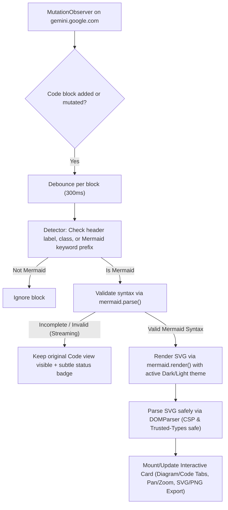

# Firefox Extension: Gemini Mermaid Renderer

## Goal Description

Build a Manifest V3 Firefox extension (`gemini-mermaid`) that automatically detects Mermaid diagram blocks in the Google Gemini web application (`https://gemini.google.com/*`) and renders them in-place as interactive diagrams.

Key capabilities:
1. **Tabbed Toggle (`Diagram` | `Code`)**: Displays the rendered Mermaid diagram by default while preserving Gemini's original code block underneath so you can switch back to raw code at any time.
2. **Pan & Zoom Controls**: Interactive viewport supporting click-and-drag panning, mouse-wheel zooming, and toolbar buttons (`+`, `-`, `Reset 100%`).
3. **Export Actions**: One-click **Download SVG**, **Download PNG** (rendered at 2x HiDPI resolution), and **Copy PNG to Clipboard**.
4. **Smart Detection & Streaming Resilience**: Identifies both explicitly labeled `mermaid` code blocks and unlabeled code blocks whose content starts with valid Mermaid diagram syntax (`flowchart`, `sequenceDiagram`, `erDiagram`, etc.). Debounces DOM mutations during Gemini's token-by-token streaming and validates syntax before switching from Code to Diagram view.
5. **Theme Synchronization**: Automatically matches Gemini's Light/Dark mode and re-renders diagrams if the user toggles the app theme.

---

## Architecture & Data Flow



---

## Proposed Changes

### 1. Project & Build Configuration

We use `esbuild` to bundle `mermaid` and our modular source files into a single self-contained content script (`dist/content.js`), and `web-ext` to lint and package the Firefox extension.

#### [package.json](../package.json)
- Configures `mermaid` as a dependency and `esbuild`, `vitest`, `jsdom`, and `web-ext` as devDependencies.
- Scripts:
  - `npm run build`: Bundles the extension into `dist/`.
  - `npm run watch`: Watches `src/` for changes during development.
  - `npm test`: Runs unit tests via `vitest`.
  - `npm run lint`: Validates the Firefox extension package via `web-ext lint`.
  - `npm run package`: Builds a distributable `.zip` in `web-ext-artifacts/`.

#### [build.mjs](../build.mjs)
- Uses `esbuild` to bundle `src/content.js` into `dist/content.js` (IIFE format, UTF-8, targeting Firefox 115+).
- Copies `manifest.json`, `src/styles.css`, and `icons/` into `dist/`.

---

### 2. Firefox Extension Manifest & Assets

#### [manifest.json](../manifest.json)
```json
{
  "manifest_version": 3,
  "name": "Gemini Mermaid Renderer",
  "version": "1.0.0",
  "description": "Identifies and renders Mermaid diagrams inside the Google Gemini web app with pan/zoom and SVG/PNG export.",
  "icons": {
    "48": "icons/icon.svg",
    "96": "icons/icon.svg"
  },
  "permissions": [
    "clipboardWrite"
  ],
  "content_scripts": [
    {
      "matches": ["https://gemini.google.com/*"],
      "js": ["content.js"],
      "css": ["styles.css"],
      "run_at": "document_idle"
    }
  ],
  "browser_specific_settings": {
    "gecko": {
      "id": "gemini-mermaid@local.extension",
      "strict_min_version": "115.0"
    }
  }
}
```

#### [icons/icon.svg](../icons/icon.svg)
- Vector icon representing a flowchart/diagram node graph styled for Firefox's add-on manager.

---

### 3. Mermaid Block Detection & Streaming Observer

#### [src/detector.js](../src/detector.js)
Handles Gemini's Angular DOM structure (`<code-block>`, `.code-block`, and standard `<pre><code>` blocks):
- **Explicit label detection**:
  - Checks `code.language-mermaid`, `code[class*="mermaid"]`.
  - Checks Gemini's code block header (`code-block .code-block-decoration span`, `.header-formatted`, etc.) for case-insensitive `"mermaid"`.
- **Syntax auto-detection** (for unlabeled/generic code blocks):
  - Strips optional YAML frontmatter (`--- ... ---`) and comment lines (`%% ...`).
  - Matches first statement against known Mermaid diagram keywords.
- **Code extraction**: Extracts raw text content from the inner `<code>` element while ignoring any injected extension UI nodes.

#### [src/observer.js](../src/observer.js)
- Attaches a `MutationObserver` to `document.body` watching `childList` and `characterData` across `subtree: true`.
- Maintains a `WeakMap` of code block elements to debounce timers (`300ms`) so token-by-token streaming updates coalesce cleanly.
- Stores a content signature on processed blocks to prevent redundant re-renders when unrelated chat UI updates occur.
- Observes class/attribute mutations on `document.body` and `document.documentElement` to re-render diagrams automatically when the user toggles Gemini between Dark and Light mode.

---

### 4. Mermaid Renderer & Safe DOM Parsing

#### [src/renderer.js](../src/renderer.js)
- **Theme detection**: Inspects `document.body` / `document.documentElement` classes/attributes and computed background luminance to select `'dark'` vs `'default'` Mermaid theme.
- **Pre-validation**: Calls `await mermaid.parse(source, { suppressErrors: true })` prior to rendering.
  - If a block fails `parse()` (e.g. still streaming or contains a syntax error), returns `{ valid: false, error }` so the UI keeps the **Code** tab visible and displays a subtle status indicator without injecting Mermaid's broken-diagram SVG.
- **CSP / Trusted Types safety**:
  - Configures Mermaid with `securityLevel: 'strict'` and `startOnLoad: false`.
  - Parses the SVG string returned by `mermaid.render()` via `new DOMParser().parseFromString(svg, 'image/svg+xml')` and imports the `<svg>` node via `document.importNode()`, avoiding raw `.innerHTML` assignments on the host document.

---

### 5. Interactive Diagram Card UI & Export Utilities

#### [src/ui.js](../src/ui.js)
- Injects a `.gm-mermaid-wrapper` bar and diagram viewport inside the Gemini code block container without removing the original `<pre><code>` element from the DOM.
- **Toolbar layout**:
  - **Left**: Segmented toggle buttons (`Diagram` | `Code`) + status badge (when streaming or if syntax error occurred).
  - **Center/Right (visible in Diagram mode)**:
    - Pan/Zoom controls: `Zoom Out (-)` | `100% (Reset)` | `Zoom In (+)`
    - Export controls: `SVG` (Download SVG) | `PNG` (Download PNG) | `Copy PNG` (Copy to clipboard with temporary `"Copied!"` confirmation state).
- **Pan & Zoom engine**:
  - Applies CSS transform `translate(panX, panY) scale(scale)` on the inner diagram canvas.
  - Supports pointer drag (`pointerdown` / `pointermove` / `pointerup`) to pan smoothly.
  - Supports mouse wheel zoom (`wheel` event) centered on the cursor position.

#### [src/exporter.js](../src/exporter.js)
- **`downloadSVG(svgElement, filename)`**: Clones the rendered `<svg>`, ensures explicit `width`, `height`, `viewBox`, and `xmlns` attributes, serializes via `XMLSerializer`, and triggers a browser download.
- **`svgToPngBlob(svgElement, isDark)`**: Renders the serialized SVG onto an offscreen `<canvas>` scaled at `2x` resolution (`scale = 2`) with a theme-matching background (`#1e1f20` for Dark mode, `#ffffff` for Light mode) and returns a `Promise<Blob>`.
- **`downloadPNG(svgElement, isDark)`** & **`copyPNGToClipboard(svgElement, isDark)`**: Uses `svgToPngBlob` to either download a `.png` file or write `new ClipboardItem({ 'image/png': blob })` to `navigator.clipboard`.

#### [src/styles.css](../src/styles.css)
- Scoped styles (`.gm-*`) using CSS variables that adapt to Gemini's Material 3 light and dark surfaces.

#### [src/content.js](../src/content.js)
- Entry point that initializes the renderer, runs an initial scan of existing code blocks in the conversation, and starts the `MutationObserver`.

---

## Verification Plan

### Automated Tests
1. **Unit & DOM Integration Tests (`vitest` + `jsdom`)**:
   ```bash
   npm test
   ```
2. **Build & Firefox Add-on Linter**:
   ```bash
   npm run build && npm run lint && npm run package
   ```

### Manual Verification
1. Open `test-harness.html` to preview the extension locally across explicit blocks, unlabeled keyword blocks, non-Mermaid Python blocks, Dark/Light toggling, and simulated streaming.
2. To load into Firefox:
   - Open `about:debugging#/runtime/this-firefox`.
   - Click **Load Temporary Add-on...** and select `dist/manifest.json` (or the packaged `.zip` in `web-ext-artifacts/`).
   - Open `https://gemini.google.com` and ask Gemini to generate a Mermaid diagram.
